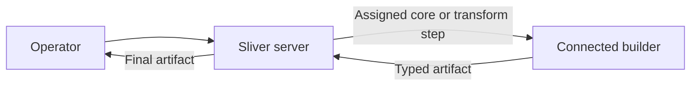

Sliver can assign individual core and transform build steps to a connected builder. This lets a server use toolchains on another machine, such as a macOS builder connected to a Linux server. The server resolves the build plan, prepares Sliver's build material, validates each returned artifact, runs following steps, and stores the final bytes.



## Start a builder

Start a `sliver-server` builder with an [operator configuration file](/docs?name=Multi-player+Mode) from the server:

```shell
./sliver-server builder -c operator-multiplayer.cfg
```

Builders follow the operator profile automatically: direct profiles use gRPC/mTLS, while profiles generated with `new-operator --enable-wg` (or `sliver-server operator --enable-wg`) contain `wg.enabled: true` and use WireGuard. Use `--enable-wg` or `--disable-wg` to override that selection; the flags cannot be combined. Profiles from the withdrawn WireGuard-by-default release may have a `wg` block without `enabled`; builders treat those profiles as direct unless WireGuard is forced explicitly.

The builder mirrors log output to stdout by default. Give each builder a unique name with `--name` if its hostname is not unique. The builder must advertise an immutable core or transform spec accepted by the server catalog, including its exact digest and compatible target, mode, protocol, artifact type, and toolchain capabilities.

Update older builders and clients with the server before using remote builds. Workers that advertise only the former format and OS/architecture targets are rejected, and the old external build RPCs are no longer available.

## Inspect builders and build

Run `builders` to see each builder's availability, status age, capacity, installed spec references, and compiler targets. Offline or stale builders remain visible for diagnosis but cannot receive new steps. Run `cores` and `transforms` to inspect the server's installed build specs. Their tables omit digests by default; use `--show-digests` to include the digest column. `cores info <name> --yaml` shows an exact core definition and digest.

Use `-E` (or `--external-builder`) to request an assigned-step build. `--builder <name>` pins the request to a particular connected builder. The server checks compatibility and capacity before assigning work, and the client verifies the downloaded final artifact against the build record.

```text
sliver > generate --mtls localhost --os mac --arch arm64 -E
sliver > generate beacon --mtls localhost --os linux --arch amd64 --builder build-host
```

Use `--plan` with either `generate` command to preview the resolved steps and providers before building. Remote builds reject settings that the assigned-step request cannot represent. `--cleanup false` is available for local generation only because a remote builder's workspace is not returned to the operator.

## Custom cores

Custom implant source is installed as a core with its own source, Magefile, and immutable spec. A builder advertises the installed spec and its capabilities at registration. Operators can select an authored YAML profile that names the core and its transforms, then run `profiles generate <name> -E` to request remote execution.
